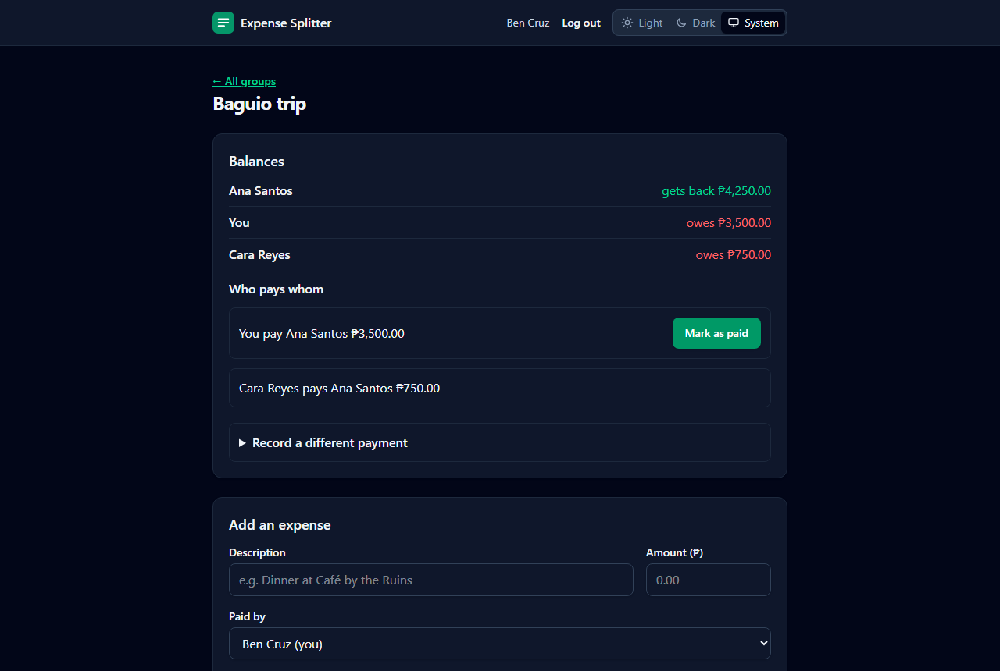
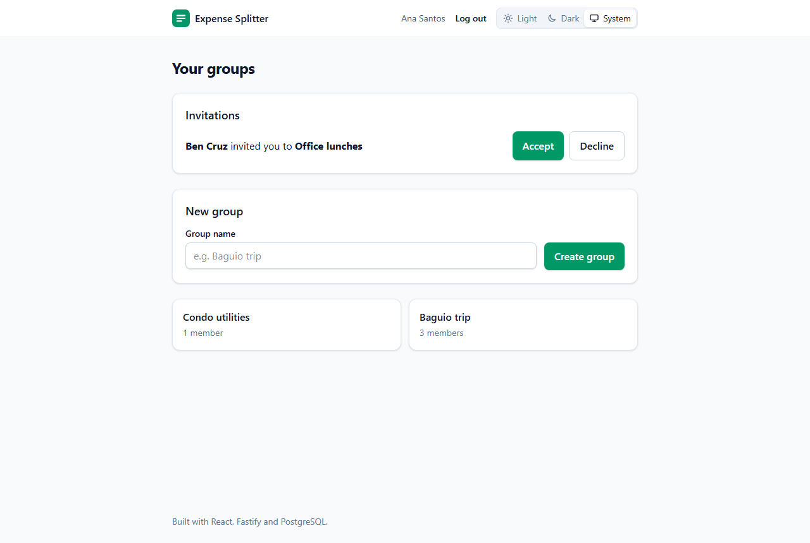
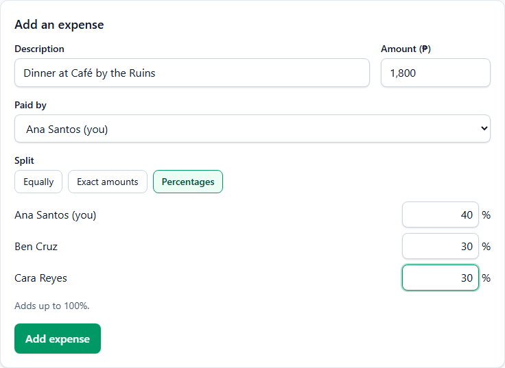
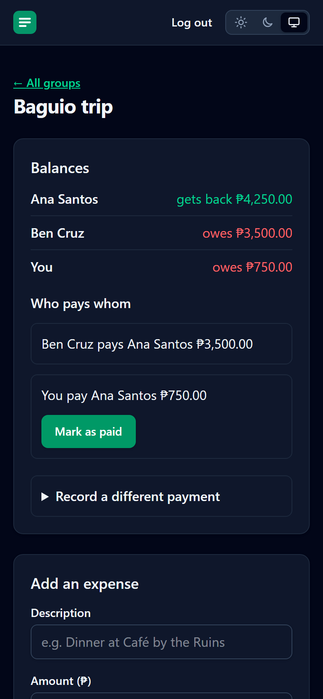

# Expense Splitter

Split shared expenses with friends, roommates or travel buddies, and see the fewest payments needed to settle up.

The app works end to end: sign up, create a group, invite friends, add expenses and settle up. Run it all with one Docker command (see [Run with Docker](#run-with-docker)).

## Screenshots



| Your groups and invitations | Splitting by percentage | On a phone |
| --- | --- | --- |
|  |  |  |

## Highlights

- **Money is stored as whole centavos**, never floats, so rounding can't lose or create money. Every split adds up to the exact total.
- **Multiple currencies**: each group settles up in its own currency (30 supported), and expenses can be paid in any of them, like yen on a trip to Japan. The server suggests the day's European Central Bank rate (via Frankfurter) and you can change it to what your card actually charged; conversion is exact (BigInt, rounded half up) and the original amount and rate are kept on the expense.
- **Three ways to split**: equally, by exact amounts, or by percentage (up to 2 decimals). Leftover centavos are distributed with the largest remainder method.
- **Friends without accounts**: add people by name only, so one person can keep the books for the whole trip. Guests can pay for things and share costs like anyone else; members record their payments for them. Guests can never log in (enforced by a database constraint).
- **Debt simplification**: if Ana owes Ben ₱500 and Ben owes Cara ₱500, the app just tells Ana to pay Cara. A greedy algorithm settles a group of _n_ people in at most _n − 1_ payments.
- **Secure authentication**: argon2id password hashing (Node's built-in implementation, OWASP settings); 15-minute access tokens and rotating 14-day refresh tokens in httpOnly, SameSite=Strict cookies that page scripts can't read; real server-side logout; reuse of a stolen refresh token ends every session; cross-site request blocking; rate-limited login and sign-up; and login answers "wrong password" and "no such account" identically, in the same time.
- **ISO 27001-aligned**: the applicable Annex A technological controls (access control, secure authentication, security event logging with secret redaction, input and rate limits, vulnerability management, CodeQL scanning) are implemented and mapped in [SECURITY.md](SECURITY.md), including the known gaps.
- **Tested at three levels**: fast unit tests on Linux, Windows and macOS; API integration tests against a real PostgreSQL database; and Playwright end-to-end tests where two real browsers sign up, share a trip and settle up.
- **Supply-chain care**: CI fails on any high or critical `npm audit` finding, Dependabot opens weekly update PRs, unreviewed package install scripts are blocked (`strict-allow-scripts`), and GitHub Actions are pinned to commit SHAs.
- **Hardened container**: one multi-stage image where the API also hosts the web app; production dependencies only, no npm, non-root user, read-only filesystem; scanned with Trivy in CI (fails on fixable high or critical vulnerabilities) and smoke-tested with the real database.

## Tech stack

**Server:** Node.js 26 · TypeScript · Fastify · Prisma · PostgreSQL · Zod

**Client:** React · TypeScript · Vite · React Router · TanStack Query · Zod · Tailwind CSS

**Tooling:** npm workspaces · Oxlint · Vitest · Testing Library · Playwright · Docker · GitHub Actions · CodeQL

## Run with Docker

The quickest way to try it: only Docker is needed.

```bash
JWT_SECRET=$(node -e "console.log(require('crypto').randomBytes(32).toString('base64url'))") docker compose up --build
```

Then open <http://localhost:8080>. Compose starts PostgreSQL, applies the migrations, and runs the app; the server refuses to start without a `JWT_SECRET` of at least 32 random characters. (On Windows PowerShell, set `$env:JWT_SECRET` first, then run `docker compose up --build`.)

## Getting started (development)

Requirements: Node.js 26+ and Docker.

```bash
docker compose up -d db                  # start PostgreSQL
cp server/.env.example server/.env       # local settings; set your own JWT_SECRET
npm ci                                   # installs server and client (npm workspaces)
npm run db:migrate -w server             # create the tables
npm run db:generate -w server            # generate the typed database client
npm run lint                             # Oxlint, including type-aware rules
npm test                                 # unit tests for server and client
npm run test:integration                 # API tests against a separate splitter_test database
npm run install-browser -w e2e           # once: download Chromium for Playwright
npm run test:e2e                         # a real browser clicks through the whole app
```

Then run the API and the web app in two terminals:

```bash
npm run dev:server                       # API on http://127.0.0.1:3000/api
npm run dev:client                       # app on http://localhost:5173
```

In development the web app forwards `/api` requests to the API, so the browser talks to a single origin; in the Docker image the API server hosts the built app itself. `npm run dev:server` runs the TypeScript source directly with Node's built-in type stripping and restarts on save. Browse the data with `npm run db:studio -w server`.

To refresh the README screenshots, start the app with Docker (above) and run `node e2e/scripts/screenshots.ts`. It creates demo people on example.com and saves the images to `docs/screenshots/`.

```
expense-splitter/
├── server/   Fastify API, Prisma schema, unit and integration tests
├── client/   React app (Vite, Tailwind), component tests
└── e2e/      Playwright end-to-end tests (two browsers, the full flow)
```

## API

| Method | Path                                  | Auth | Description                                       |
| ------ | ------------------------------------- | ---- | ------------------------------------------------- |
| GET    | `/api/health`                             | –    | Server and database status                        |
| POST   | `/api/auth/register`                      | –    | Create an account and log in                      |
| POST   | `/api/auth/login`                         | –    | Log in                                            |
| POST   | `/api/auth/refresh`                       | 🍪   | Renew the login (new tokens)                      |
| POST   | `/api/auth/logout`                        | 🍪   | End this device's session                          |
| GET    | `/api/auth/me`                            | ✔    | The logged-in user                                |
| GET    | `/api/groups`                             | ✔    | Groups you belong to                              |
| POST   | `/api/groups`                             | ✔    | Create a group in a currency (default PHP)        |
| GET    | `/api/groups/:groupId`                    | ✔    | Group details and members                         |
| POST   | `/api/groups/:groupId/invitations`        | ✔    | Invite someone by email                           |
| GET    | `/api/groups/:groupId/invitations`        | ✔    | Invitations waiting to be accepted                |
| DELETE | `/api/groups/:groupId/invitations/:id`    | ✔    | Cancel an invitation                              |
| POST   | `/api/groups/:groupId/leave`              | ✔    | Leave (only once your balance is zero)            |
| POST   | `/api/groups/:groupId/guests`             | ✔    | Add someone by name only (no account)             |
| DELETE | `/api/groups/:groupId/guests/:guestId`    | ✔    | Remove a guest (only once their balance is zero)  |
| GET    | `/api/invitations`                        | ✔    | Invitations sent to you                           |
| POST   | `/api/invitations/:id/accept`             | ✔    | Join the group                                    |
| POST   | `/api/invitations/:id/decline`            | ✔    | Decline                                           |
| GET    | `/api/groups/:groupId/expenses`           | ✔    | Expenses, newest first                            |
| POST   | `/api/groups/:groupId/expenses`           | ✔    | Add an expense (equal, exact or percentage split) |
| DELETE | `/api/groups/:groupId/expenses/:expenseId`| ✔    | Delete an expense                                 |
| GET    | `/api/groups/:groupId/balances`           | ✔    | Each member's balance and the fewest payments     |
| GET    | `/api/rates?from=JPY&to=PHP`              | ✔    | Today's suggested exchange rate                   |
| GET    | `/api/groups/:groupId/settlements`        | ✔    | Recorded payments, newest first                   |
| POST   | `/api/groups/:groupId/settlements`        | ✔    | Record a payment you made, or one a guest made    |

Logging in sets two httpOnly cookies: a 15-minute access token sent with every API request, and a refresh token (🍪) that `/api/auth/refresh` exchanges for new ones. Tokens never appear in response bodies. Requests that change data from other websites are refused. All amounts are **whole centavos** (₱150.75 → `15075`). Errors always look like `{ "error": "EmailTaken", "message": "..." }`. Only members can see or change a group; to anyone else it returns the same 404 as a group that doesn't exist.

Adding an expense:

```json
{
  "description": "Dinner",
  "amount": 300000,
  "paidById": "optional, defaults to you",
  "split": { "type": "EQUAL" }
}
```

`split` can also be `{ "type": "EQUAL", "userIds": [...] }`, `{ "type": "EXACT", "shares": [{ "userId": "...", "amount": 1000 }] }` or `{ "type": "PERCENTAGE", "shares": [{ "userId": "...", "percent": 33.33 }] }`.

## Roadmap

- [x] Split and settlement logic with tests
- [x] Database schema (Prisma) and Fastify server
- [x] Authentication (register, login, JWT)
- [x] Groups, expenses and balances API
- [x] React frontend: log in / sign up, groups and invitations, expenses, balances and settling up
- [x] Playwright end-to-end tests in CI (two browsers, sign-up to settled up)
- [x] Docker image (API hosts the app), Trivy scanning and smoke test in CI
- [ ] Published multi-platform image (amd64 + arm64) and a live demo

## License

[MIT](LICENSE)
